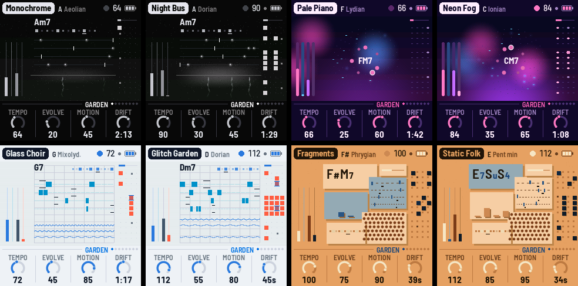

# HALF-LIGHT for the M-VAVE FM-1

HALF-LIGHT turns the M-VAVE FM-1 into a generative ambient machine in four eras, two pieces each: **After Dark**
(monochrome and intimate), **Long Glow** (big pads, soft piano, neon haze), **Clean Signal** (a formant choir,
strings, glitching bells) and **Cut & Paste** (fragments, two-step pulses, cold electronics). It plays itself from
the moment it is switched on, and every era has its own moving screen that follows the sound. It is a fork of
Charles Vestal's [AMB-1](https://github.com/charlesvestal/fm1-amb).



- **Try it in the emulator** (no FM-1 needed): open <https://joakimeriksson.github.io/fm1-emu/?fw=local&mhz=120>,
  choose **Open .fwsc…**, pick `halflight.fwsc`, press **Start**
- **Read the manual**: [docs/MANUAL.md](docs/MANUAL.md)
- **The eras**: what each sounds and looks like, and why: [docs/ERA_BIBLE.md](docs/ERA_BIBLE.md),
  [docs/VISUAL_SYSTEM.md](docs/VISUAL_SYSTEM.md), the captures in [docs/visuals](docs/visuals)
- **Download the firmware file**: [releases](https://github.com/davidaparicio2205-dotcom/fm1-amb/releases), or the
  *firmware* artifact of a CI run

Installing it is at your own risk, though it is hard to get stuck: M-VAVE's own firmware can be put back with
the same tools, and an FM-1 that fails to start twice comes up in a safe mode an installer can reach.

## In short

| | |
|---|---|
| Keys | The scale: each key adds its note or takes it out |
| PLAY · REC · EDIT | Grow / rest · freeze · the next chord |
| HOME · ENV · ARP · LFO · SEQ · FX · GLO · SEL | The pages: Garden, Pad, Bells, Bass, Pulse, Space, Setup, Colour; KNOB 1–4 set their values |
| SELECT | The previous or next page; with HOME held, the tempo |
| ALGORITHM · PRESETS | The mode · the piece (eight, two an era) |
| OCT− / OCT+ | The bells' octave |
| SAVE | Saves; held, puts the piece back to its recipe |

Hold any button for a second and a card says what it does. HALF-LIGHT also tells the
[FM-1 Screen Reader](https://charlesvestal.github.io/fm1-reader/) what its screen shows, over USB.

## Building and testing

HALF-LIGHT is an app on [fm1-base](https://github.com/charlesvestal/fm1-base) (`base/`, a git submodule); clone
with `--recursive`. The toolchain and prerequisites are in [BUILDING.md](BUILDING.md), the subsystems and limits in
[docs/ARCHITECTURE.md](docs/ARCHITECTURE.md):

```
sh tests/run_tests.sh                       # the instrument, the app in a simulator, the web builds
sh tools/render_all.sh 60 app/build/render  # every piece rendered offline and measured against the targets
python3 tools/capture_visuals.py            # the eras' screens (GIFs, stills, sheets) into docs/visuals
./build.sh                                  # app/build/halflight.fwsc
tools/emulator_check.sh app/build/halflight.fwsc PATH/TO/fm1-live OUTDIR   # the emulator gate, 120 MHz
```

Every pull request builds the package and runs all of this in CI (`.github/workflows/ci.yml`).

## Credits

HALF-LIGHT is Charles Vestal's AMB-1 with four eras added: the engine, the garden, the pages, the screen reader
and the project are his. AMB-1's idea comes from Brian Eno's generative music (*Music for Airports*, *Discreet
Music*). The reverb is Jon Dattorro's plate ("Effect Design, Part 1", JAES 1997), as in
[FoMni-1](https://github.com/charlesvestal/fm1-fomni). It is built on [fm1-base](https://github.com/charlesvestal/fm1-base)
and [felucca-bsp](https://github.com/hugelton/felucca-bsp), from [Felucca](https://github.com/hugelton/Felucca) by
Leo Kuroshita (Hügelton Instruments), and tested in Joakim Eriksson's [fm1-emu](https://github.com/joakimeriksson/fm1-emu).
The eras take their mood from a band's ambient and instrumental work and copy nothing of it
([docs/ERA_BIBLE.md](docs/ERA_BIBLE.md), the self-audit). MPL-2.0; see [LICENSING.md](LICENSING.md).

M-VAVE and FM-1 are trademarks of their owners. HALF-LIGHT is not affiliated with M-VAVE, Brian Eno,
Hügelton Instruments or any band.
