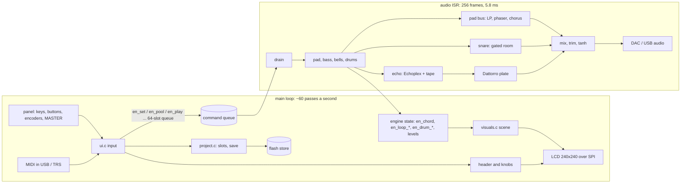

# HALF-LIGHT: architecture

HALF-LIGHT is a fork of AMB-1 (`charlesvestal/fm1-amb`, upstream). It runs on fm1-base (`base/`, a git submodule,
with felucca-bsp inside), the platform for M-VAVE FM-1 apps derived from Leo Kuroshita's Felucca.

## The repository

| Path | What |
|---|---|
| `app/dsp/amb.c`, `amb.h` | the engine: pad, bells, bass, pulse, echo, plate, chorus, phaser, gated room, the 8 recipes (own unit, `-O2`) |
| `app/project.c` | the saved project (format 5) and the migration from formats 3 and 4 |
| `app/ui.c` | input, the header, the knob strip, the help cards, the screen reader |
| `app/era_palette.h`, `app/visuals.c` | the eras' palettes and scenes (the main band), the intro, the splash |
| `app/app.c`, `app.h`, `host.c` | the glue to fm1-base's contract, the app's identity, the simulator's checks |
| `app/fm1.toml` | the build's settings: name `HALFLIGHT`, identity `FM-1_84xx`, USB strings |
| `tests/host/amb_test.c` | engine unit tests |
| `tests/host/render.c` | **the offline render harness** (the same `amb.c`, `-DEN_HOST`) |
| `tests/scenarios/*.amb` | the whole app in fm1-base's simulator (UI, pieces, migration, screen reader) |
| `tools/render_all.sh`, `tools/metrics.py` | every piece rendered and measured, the targets checked |
| `tools/capture_visuals.py` | the eras' screens as GIFs, stills and contact sheets (`docs/visuals/`) |
| `.github/workflows/ci.yml` | PR/branch CI: the `.fwsc` from source, every test (blocking), metrics, 30-min stability |
| `.github/workflows/release.yml` | tag releases through the shared attested builder (zvenson/fm1-build) |

**Structural changes and why:**
- `visuals.c` and `era_palette.h` are split from `ui.c`. Four scenes would have doubled `ui.c`, and the palette has
  to be declared before the header code.
- `ci.yml` was added. `release.yml` runs only on tags and does not block on tests (`tests-block: false`), so before
  this nothing checked a pull request.
- The package name and identity changed (`HALFLIGHT`, `FM-1_84`), so the fork and AMB-1 (`FM-1_7`) never collide on
  a device or a hub.

## Data flow

## Limits

| What | Value | Source |
|---|---|---|
| Display | 240 × 240, RGB565 big-endian, ST7789-class over SPI1, no tearing line | `base/device/lcd.c` |
| SPI | divider 0 = 60 MHz, ~44 MHz effective (measured upstream); a 240×144 band ≈ 12.6 ms | `lcd.c` |
| Frame buffer | none: one 240×144 canvas (69 KB, in the pool), drawn into and blitted by DMA | `base/device/gfx.c` |
| Drawing | `cv_rect`, `cv_text` (Barlow fonts T, XS, S, B, M, L), `cv_round`; the app's own AA discs, glows, blends | `gfx.c`, `ui.c`, `visuals.c` |
| UI frames | main loop calls `app_frame` at most every 16 ms (~60/s). The main band is redrawn every 2nd frame (**30/s**). Header and knobs only when they change | `main_fm1.c`, `ui.c` |
| CPU | JieLi AC79 (pi32v2), 240 MHz on the FM-1. The emulator's `mhz=120` is the project's test clock (2× margin) | prompt, fm1-emu |
| Audio | 44.1 kHz stereo, 24-bit in int32, a block of 256 frames (5.8 ms) per interrupt | `app.h` |
| Audio budget | `plat_cpu_pct()`: the render's time as a % of its block, smoothed over 16 blocks (Setup's header shows it). Measured at 120 MHz in fm1-emu, 5 min a piece: averages 49–71 %, worst 67–82 %, 0 xruns | `main_fm1.c`, the PR |
| Voices | pad 4, bells 8 (6 before; stutter), drums 3 (kick, closed hat, snare/open hat), bass 1 (sine + sub + 2 harmonics) | `amb.c` |
| Image | 121 976 B before, **147 648 B** now (the app slot's limit is checked by the build) | CI build log |
| RAM | `.data+.bss` 44 868 B before, **68 428 B of 98 304** now (chorus 4 KB, room 17 KB, bells, UI state) | CI build log |
| Pool | 332 208 B of 344 064, unchanged (plate ~108 KB, tape 124 KB, canvas 69 KB). The build insists on 8 KB spare, so the new buffers went in `.bss` | CI build log, `build.py` |
| Command queue | 64 commands a block: a piece change posts 36 | `amb.c` |

## The emulator (fm1-emu)

- `https://joakimeriksson.github.io/fm1-emu/?fw=local&mhz=120` is the project's test target.
- **`fw=local`** (from `web/main.js`) selects the package last opened from this computer: **Open .fwsc…** or a
  file dropped on the synth. It is kept in the browser's storage as the entry `"local"`, and the list shows it as
  "*name* (your file)". With `fw=local` and no file opened before, the page falls back to its default firmware.
  Each package version keeps its own saved flash.
- **`mhz=120`** sets the emulated clock. It must be one of the page's offered clocks, and the last one picked is
  remembered.
- **Headless**: the release binaries `fm1-live --fwsc F --mhz 120 --shot MS [--record DIR] [--lcd-only]` with
  `FM1_BENCH_KEYS='T:KEY,...'` for scripted input, and `fm1-emu` (the batch runner) with `--keys`, `--wav`,
  `--snap`. The project's emulator gate uses them (`tools/emulator_check.sh`).

## Risks

| Risk | Weight | Mitigation |
|---|---|---|
| The UI's per-pixel glows (eras 1 and 2) cost more on the device than the frame budget | medium | measured as the frame rate on Setup in the emulator at 120 MHz. The glows are bounded (radius ≤ 50 px, a few per frame) |
| The audio's new DSP pushes the load near the budget at 120 MHz | medium | measured in the emulator (Setup's CPU). The chorus, phaser and room are skipped at 0 |
| The emulator's timing is not the device's | medium | `FM1_STRICT=1` measured cycles. The hardware test checklist |
| Old saved projects | low | format 5. 3 and 4 migrate (tested: `migrate.amb`); anything else resets to defaults |
| Taste: the renders and frames are right but the music or the look is not what the player wants | unknown | the listening and hardware checklists in the PR |
