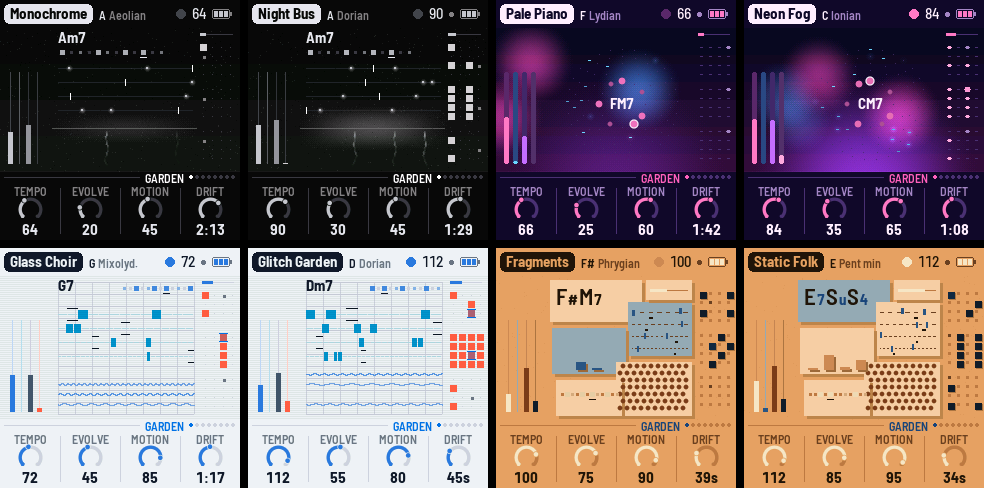
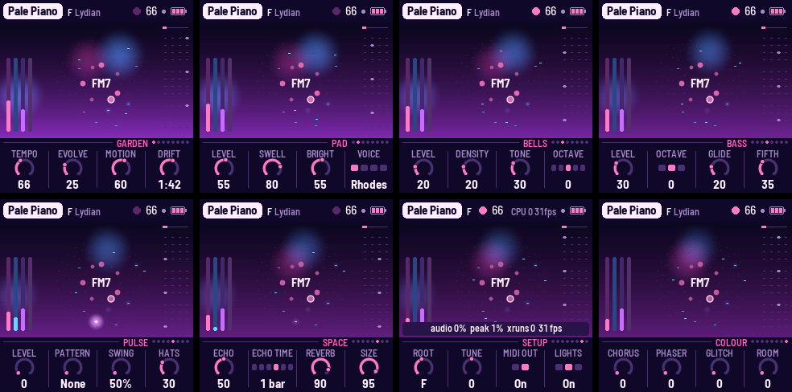
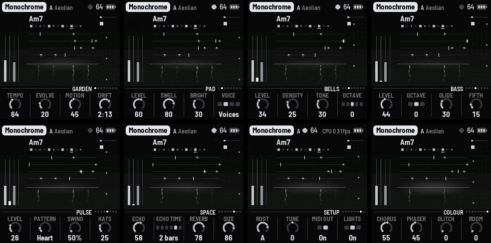

# HALF-LIGHT

HALF-LIGHT turns your M-VAVE FM-1 into a generative ambient machine in four eras, two pieces each. Switch it on
and it plays by itself: breathing pads, soft bells on tape loops of different lengths, a deep sustained bass and
a quiet fixed pulse, all through a tape echo and a plate reverb. Each era has its own sound and its own moving
screen:

| PRESETS | Era | Pieces | The sound | The screen |
|---|---|---|---|---|
| 1–2 | **After Dark** | Monochrome, Night Bus | night and intimacy: a chorused, phased pad, a heartbeat or an '80s pulse with a gated snare | black and white, film grain, city lights passing, a wet road |
| 3–4 | **Long Glow** | Pale Piano, Neon Fog | wide and cinematic: big pads, soft piano, long reverb | neon pink and cold blue, haze and bloom |
| 5–6 | **Clean Signal** | Glass Choir, Glitch Garden | clean and digital: a formant choir, synth strings, stuttering bells | white, a grid and scanlines, glitches in the full half |
| 7–8 | **Cut & Paste** | Fragments, Static Folk | fragments: broken and two-step pulses, cold electronics, uneasy bells | a collage of cards that cut on the beat |

HALF-LIGHT is a fork of Charles Vestal's AMB-1. You don't perform it so much as tend it: pick a piece and a scale,
take notes out, put them back, and let it grow.



---

## Contents

1. Install
2. Getting started
3. Controls
4. The screen
5. The garden
6. The pieces
7. The pages
8. MIDI
9. Saving
10. Troubleshooting
11. Parameters
12. Credits

---

## 1. Install

To try HALF-LIGHT first, open the [FM-1 emulator](https://joakimeriksson.github.io/fm1-emu/?fw=local&mhz=120),
choose **Open .fwsc…** and pick `halflight.fwsc` (or drop the file on the synth), then press **Start**. It runs the
same firmware in your browser, at half the FM-1's clock.

To install it, download `halflight.fwsc` from the
[releases page](https://github.com/davidaparicio2205-dotcom/fm1-amb/releases) (or a CI build's *firmware*
artifact), then use the FM-1 web installer of fm1-base, which this firmware is built on, or the command line below.
Connect the FM-1 with a USB data cable. Don't unplug it while it's writing. When it's done, the FM-1 restarts into
HALF-LIGHT.

To go back to M-VAVE's firmware, install M-VAVE's FM-1 V15 or V16 file the same way (or with M-VAVE's own updater,
M-UPGRADE). HALF-LIGHT has its own package identity (FM-1_84…), so it never claims to be AMB-1, and AMB-1 can be
installed over it, or it over AMB-1.

> Installing other firmware is at your own risk. If the FM-1 ever won't start, see
> [Recovering an FM-1 that won't start](#recovering-an-fm-1-that-won-t-start).

<details><summary>Install from the command line</summary>

Get the source (`git clone --recursive https://github.com/davidaparicio2205-dotcom/fm1-amb`), install Python 3
with `pip3 install mido python-rtmidi`, and run:

```
python3 base/tools/fm1_install.py halflight.fwsc
```

</details>

---

## 2. Getting started

HALF-LIGHT starts playing as soon as you switch it on. Try this:

1. **Listen.** The first piece, Monochrome, is playing in A Aeolian, with the pad, bells, bass and a heartbeat
   kick. Turn MASTER to set the volume.
2. **Try another era.** Turn PRESETS. The pieces come in pairs, an era each. The screen changes its world as
   the era changes.
3. **Change the scale.** Press a key whose note is lit to take that note out of the scale, so
   nothing plays it. Press it again to bring it back. Press a key that isn't lit to add its note.
4. **Move on.** Press EDIT, and the pad moves to the next chord at the start of the next bar.
5. **Freeze.** Press REC to hold the chord and let the reverb ring on forever, while the bells and
   pulse go on above it. Press REC again to let it go.
6. **Shape a layer.** Each layer has its own button: ENV for the pad, ARP for the bells, LFO for
   the bass and SEQ for the pulse. FX opens the space, SEL the colour, HOME the garden as a whole, and GLO the
   setup. Turn KNOB 1–4 to set the four values at the bottom of the screen. Turn SELECT to step through the pages.
7. **Rest.** Press PLAY, and the garden stops growing while its sounds slowly fade out. Press PLAY
   again and it grows back.

Each piece keeps what you change. HALF-LIGHT saves by itself while it rests, or you can press SAVE.

To find out what a button does, hold it for a second to see a card. Let go and nothing happens.

---

## 3. Controls

The drawing at the top shows every control. Here they are in more detail.

| Control | What it does |
|---|---|
| Keys | The keys are the scale, and they light up for the notes in it. Press a key to add its note or take it out. Every octave of a note is the same key. The root always stays, and the scale keeps at least three notes. |
| PLAY | Grows or rests the garden. HALF-LIGHT starts growing by itself when you switch it on. When it rests, the sounds slowly fade out and the reverb rings away. PLAY is lit green while it grows. |
| REC | Freezes the chord. The reverb rings on forever, while the bells and pulse go on dry above it. Press REC again to thaw. It's lit while frozen. |
| EDIT | Moves to the next chord at the start of the next bar, or right away while resting. |
| HOME | Opens the Garden page, for the whole garden. |
| SEL | Opens the Colour page: chorus, phaser, glitch and the snare's room. |
| ENV · ARP · LFO · SEQ | Open the layers' pages: Pad, Bells, Bass and Pulse. |
| FX · GLO | Open the Space and Setup pages. The lit button shows which page you're on. |
| SELECT | Turns to the previous or next page. To change the tempo from any page, hold HOME and turn SELECT. |
| ALGORITHM | Picks the mode: Ionian, Dorian, Phrygian, Lydian, Mixolydian, Aeolian, or pentatonic major or minor. It loads the mode's scale. Once you change the scale with the keys, it's Custom. |
| PRESETS | Picks the piece: two an era, in order. For the list, see [The pieces](#6-the-pieces). |
| KNOB 1–4 | Set the four values on the screen. A few clicks always move one step at a time, and a quick turn speeds up, so half a turn sweeps the whole range. |
| OCT− / OCT+ | Move the bells down or up an octave, up to two either way, from any page. |
| MASTER | Sets the volume. |
| SAVE | Saves all eight pieces. Hold it for 1.5 s to put the piece back to its recipe. |

To find out what a button does, hold it for a second (any button but PLAY), and a card explains it.
A key, a knob or another button puts the card away, and letting go does nothing else.


---

## 4. The screen



The screen has three parts. The top line and the knobs at the bottom stay plain, in the era's colours. The middle
is the era's scene: the instrument itself, drawn in that era's way, moving with the sound (see
[VISUAL_SYSTEM.md](VISUAL_SYSTEM.md)).

- The top line shows the piece, its root and its mode. On the right are a slow beat light (a play
  triangle while resting), the tempo (EXT when it follows MIDI clock), a dot when there are unsaved
  changes, and the battery. Messages such as "ADDED F#" and "NEXT CHORD" show here for a moment.
- The battery shows three bars when it's full, and fewer as it runs down. At one bar or none it
  turns red, and it's time to charge. When it's plugged into a computer, it shows a lightning bolt.
- In every era's scene you'll find the same things:
  - **the chord** and its name, and **the scale**: twelve marks from C (or the ring, in the Long Glow). Notes in
    the scale are marked, the chord's notes are bright, and the root is underlined.
  - **the four bell loops**, 13, 17, 23 and 29 beats long: rows of lights, rings, sequencer rows or torn strips.
    Each note is a point, the playhead moves along, and a strike glints.
  - **the three drums** on the right, each a bar of 16 steps as 4 × 4, with the step now marked.
  - **the four layers' levels** on the left: pad, bells, bass and pulse, as they sound.
  - **the way to the next chord**: a thin bar at the top right that fills up. While frozen, it says "held".
- How the sound moves it: the pad's voices are the big slow shapes (reflections, glows, signal lines, paper bars).
  The bass breathes through the whole scene. The kick and snare move one line or edge, tightly. The echo leaves
  trails. Over minutes, the slow tide changes the grain, the haze, and (in Clean Signal) brings in the glitches.
- When PRESETS moves to another era, the colours morph and the old era dissolves over about a second.
- At the bottom are the page's name and eight dots, one for each page, then its four values, one
  for each knob. Each value has a dial (or, for a switch, its positions). The one you're turning lights up.

---

## 5. The garden

HALF-LIGHT grows four layers from one scale and one chord.

- The **pad** is four breathing voices. Each one swells in, hangs and fades on its own cycle. The
  cycles have different lengths, around 11 to 19 seconds at first, like the tape loops of "2/1".
  Each voice takes its note of the chord as it starts, so the chord forms and dissolves instead of
  sitting still. The pad has four voices: a filtered **Rhodes** that blooms brighter as it swells, sung
  **Voices**, synth **Strings** (two saws a little apart, through a soft low-pass) or a **Formant** choir (a buzz
  through two narrow vowel resonances, like a vocoder with no words). After the pad come, by piece, a **phaser**
  (the swirl of a phased guitar) and a Juno-style **chorus**.
  Every so often (set by **Drift**), the chord moves to another one in the scale. Voices on notes
  the new chord shares hold to the end of their breath. The others fade out and breathe in again on
  their new notes.
- The **bells** are FM bells, struck softly like a piano slowed to half speed. Four tape loops play
  them, 13, 17, 23 and 29 beats long. Each loop holds a few notes, so the loops slide against each
  other and the melody never quite repeats. Each loop has its own shade of bell, and now and then a
  note rings with its octave. With **Glitch**, a bell now and then stutters on the 32nd notes, like a buffer caught
  repeating.
- The **bass** is a deep drone on the chord's root, with a slow attack. It glides to each new root and
  breathes with the change: a short dip, then a slow swell back over about a second and a half. Sometimes it leans
  on the fifth.
- The **pulse** is a deep kick tuned to the piece's root (it stays put while the chords move), a closed hi-hat,
  and an open hat or a snare. **Pattern** picks one of eight fixed grooves: none, heartbeat, half-time, '80s pop,
  four on the floor, UK dance, two-step and broken. Each plays the same every bar. The snare can ring through a
  **gated room**: a burst of space that stops dead, the '80s way.

Then comes the space, after Eno's chain for *Discreet Music*: a short tape echo, a long tape loop
and a plate reverb. The tape loop is up to 5.6 seconds long and has two heads, and each repeat
comes back darker and thinner. The space is most of what you hear. The echo is stereo, and it
changes as it goes. With **Motion** up, its two heads wander across the stereo field and the
repeats fall in changing patterns. Now and then the second head slides to another part of the
loop, bending the repeats a little as it goes.

Two things move over it all:

- A slow tide takes a few minutes to swing between sparse and full. Sparse means fewer bells, a
  darker pad and more reverb (the pulse keeps its strength). **Motion** sets how far it swings, and how far the
  smaller things wander: pitch, pan, the vowel and the echo's heads.
- With **Evolve** up, the layers take rests. The bass skips a chord, or a bell loop goes quiet for one time
  round.

---

## 6. The pieces

Turn PRESETS to choose one of eight pieces, two an era. Each piece is a recipe for the whole garden: the
layers, the sounds, the tempo, key and mode, how busy it is and how far it moves. Each one
remembers how you left it. To put the piece you're on back to its recipe, hold SAVE for 1.5 s.
Tune, MIDI out and Lights are shared by all the pieces. Why each piece sounds as it does is in
[ERA_BIBLE.md](ERA_BIBLE.md).

| | Piece | What it is |
|---|---|---|
| After Dark | **Monochrome** | A Aeolian, 64: a chorused, phased Voices pad, a heartbeat kick, a long reverb and a 4-bar echo. |
| | **Night Bus** | A Dorian, 90: Strings with chorus, an '80s pulse with a gated snare. |
| Long Glow | **Pale Piano** | F Lydian, 66: a soft Rhodes, sparse bells, a very long reverb, no pulse. |
| | **Neon Fog** | C Ionian, 84: sung Voices, a soft '80s pulse, more bells. |
| Clean Signal | **Glass Choir** | G Mixolydian, 72: the Formant choir, half-time, bells that stutter now and then. |
| | **Glitch Garden** | D Dorian, 112: Strings, a UK-dance pulse, glitching bells. |
| Cut & Paste | **Fragments** | F# Phrygian, 100: a broken pattern, restless phrases (Evolve 75), glitches, a long echo. |
| | **Static Folk** | E pentatonic minor, 112: two-step with swing, the Formant choir, stuttering bells. |

---

## 7. The pages

Each layer has its own page and its own button, with four values on KNOB 1–4. On the layers' pages KNOB 1 is
the layer's level. Turn SELECT to step through the pages in this order: Garden, Pad, Bells, Bass, Pulse, Space,
Setup, Colour.



### HOME: Garden


- **Tempo** goes from 30 to 120. You can also hold HOME and turn SELECT from any page.
- **Evolve** sets how restless the garden is. At 0, the loops repeat exactly. Turn it up, and now
  and then a bell note changes or moves as its loop comes round, the pulse patterns turn and gain
  or lose a hit, and the layers take rests.
- **Motion** sets how far the tide swings, and how much the pitch, pan, vowel and echo wander. At
  0, the echo stays put, with one head left and one right.
- **Drift** sets how long a chord lasts before the pad moves on, from 20 seconds to 5 minutes,
  each time a little more or less. Press EDIT to move on now.

### ENV: Pad


- **Level** sets the pad's volume.
- **Swell** sets how long the voices breathe, from a few seconds to about half a minute.
- **Bright** opens the pad's filter and brightens the Rhodes and the Strings. With Voices, it also moves the vowel
  from "oo" to "eh". With Formant, it leans the wandering vowel brighter.
- **Voice** picks Rhodes, Voices, Strings or Formant. Each piece keeps its own.

### ARP: Bells


- **Level** sets the bells' volume.
- **Density** sets how many notes each loop holds, from none at 0 to five at the top. You'll hear
  the change as each loop comes round.
- **Tone** goes from round and softly struck to a long metallic clang.
- **Octave** moves the bells up to two octaves down or up. OCT− and OCT+ do the same.

### LFO: Bass


- **Level** sets the bass's volume.
- **Octave** puts the bass one octave down, at home, or one octave up.
- **Glide** sets how slowly the bass slides to its next note, from a quick step to over a second.
- **Fifth** sets how often the bass leans on the fifth, halfway through a chord.

### SEQ: Pulse


- **Level** sets the pulse's volume.
- **Pattern** picks the groove: None, Heart (one kick a bar), Half (half-time), '80s (kick and a backbeat snare),
  Four (four on the floor), UK (a broken kick, busy hats), 2-step (garage, best with Swing) and Broken. Each is
  fixed: the same every bar.
- **Swing** pushes the off sixteenths later, from straight (50%) to a heavy lilt (75%).
- **Hats** goes from dark and long to bright and crisp.

### FX: Space


- **Echo** sets how much goes to the echoes.
- **Echo time** sets the tape loop's length: a dotted quarter, a half, a dotted half, or 1, 2 or 4
  bars. At slow tempos, it's shortened to fit the loop's 5.6 seconds. The second head repeats at
  three quarters of that. With Motion up, it moves between two thirds, five eighths, a half and
  three eighths.
- **Reverb** sets how much goes to the plate.
- **Size** sets how long the plate rings, from a room to a long hall, and how many times the echo
  comes back.

### GLO: Setup


- **Root** sets the key's root note, and the scale moves with it.
- **Tune** fine-tunes HALF-LIGHT by up to 50 cents either way.
- **MIDI out** turns MIDI out on or off.
- **Lights** has three settings. With On, the keys light the scale, and the unlit buttons glow
  dimly so you can find them on the black FM-1. With Keys, only the keys light. Off turns the
  lights off.

On this page the top line shows the audio load (CPU) and the screen's frames a second, and the foot of the scene
shows the audio load now and at its worst since power-on, the audio blocks missed (xruns, which should stay 0) and
the frame rate.

### SEL: Colour

- **Chorus** is a Juno-style chorus on the pad, from none to thick and wide (the dry pad stays whole, so it
  thickens in mono).
- **Phaser** sweeps the pad slowly (8 s), like a phased guitar.
- **Glitch** makes the bells stutter on the 32nd notes now and then: more often, and with more octave jumps, as it
  goes up.
- **Room** is the snare's gated room: a burst of bright space that stops dead after a fifth of a second. It needs a
  pattern with a snare ('80s, UK or 2-step).

---

## 8. MIDI

MIDI comes in over USB and the TRS jack, and goes out over USB.

- A note on channel 1 adds its note to the scale or takes it out, like a key.
- When MIDI clock comes in, HALF-LIGHT follows its beat, and start and stop start and stop the garden.
  The screen shows EXT for the tempo.
- MIDI out is on by default. The pad plays on channel 1, the bells on 2, the bass on 3 and the
  pulse on 10. When HALF-LIGHT runs on its own tempo, it also sends clock, start and stop. Turning MIDI
  out off sends all notes off.

### Screen reader

HALF-LIGHT can tell a screen reader what its screen shows. Connect the FM-1 by USB, open
[FM-1 Screen Reader](https://charlesvestal.github.io/fm1-reader/) in Chrome or Edge, and click
Connect. It reads out the page you're on and its knobs, a knob's value as you turn it, the piece
and its key, the notes you add or take out, help cards, every message, and the chord each time
the garden moves on. It says them in words, such as "E flat pentatonic minor" rather than
"Eb Pent min".

The page can speak with its own voice, or pass everything to your own screen reader (VoiceOver,
NVDA, JAWS or TalkBack). Press W to hear the whole screen again: the page, the piece, the battery,
the chord and the scale. The FM-1 stays quiet until the page connects, so a DAW on the same cable
never sees it.

---

## 9. Saving

HALF-LIGHT keeps all eight pieces in the FM-1's memory, each as you left it: the knobs, the scale,
the tempo, the pad's sound and the bells' octave, plus Tune, MIDI out and Lights.

- HALF-LIGHT saves by itself a few seconds after a change, but only while it rests. Writing to the
  memory interrupts the sound for a moment, so it never saves while the garden grows. A dot at the
  top of the screen means there are unsaved changes.
- Press SAVE to save now, whether it's playing or not.
- Hold SAVE for 1.5 s to put the piece back to its recipe. That isn't saved until the next save,
  so if you switch off before then, your version comes back.
- Coming from AMB-1 or an earlier build of this fork: the pieces in the eight slots are other pieces now, so each
  starts from its new recipe. Tune, MIDI out, Lights and the piece you were on carry over. Anything the firmware
  can't read starts from the defaults.

---

## 10. Troubleshooting

To put the FM-1 in update mode, hold REC while you switch it on. If you installed m-bootloader
with the web installer, the installer can reach the FM-1 from there, and holding PLAY instead
opens m-bootloader's recovery menu. Without m-bootloader, REC starts the chip's own update mode,
which only the rescue below can reach.

If a button or knob does the wrong thing, calibrate the panel. Hold OCT− and OCT+ while you switch
the FM-1 on, and the screen asks you to press each button and turn each knob in turn.

If HALF-LIGHT crashes, it shows a red CRASH screen and restarts by itself a few seconds later. The next
start shows RESTARTED AFTER A CRASH and an address (PC ...) for a moment. If you report the
problem, include that address and what you were doing.

If HALF-LIGHT crashes twice in a row while starting, it starts in SAFE MODE instead. There's no sound,
but USB works, so the web installer can reach it. Reinstall HALF-LIGHT, or put the stock firmware back
from the same page. Press PLAY to try starting HALF-LIGHT normally again. If even safe mode fails twice,
the FM-1 drops into the chip's own update mode, and only the rescue below can reach it.

### Recovering an FM-1 that won't start

An FM-1 in the chip's own update mode shows a blank screen, and neither the web installer nor
M-VAVE's updater can see it. A script can put M-VAVE's firmware back, on a Mac, with the USB cable
you already have.

Open Terminal, paste this line and press Return:

```
bash -c "$(curl -fsSL https://raw.githubusercontent.com/hugelton/felucca-bsp/main/tools/fm1_rescue.sh)"
```

1. If a window asks to install the command line developer tools, click Install. When it has
   finished, paste the line again.
2. If it asks for a password, type your Mac password (nothing shows as you type) and press Return.
3. When it says it's waiting, plug the FM-1 in and switch it on. If it starts normally instead,
   switch it off, then hold REC while you switch it back on. The script catches it, checks the chip,
   saves a backup of the FM-1's memory in the `fm1-rescue` folder in your home folder, and asks
   before it writes anything.
4. Type **yes** and press Return. Don't unplug anything until it says it's restarting the FM-1.
   The FM-1 then starts into its original firmware, and you can install HALF-LIGHT again from there.

The script downloads M-VAVE's FM-1 firmware (V16 and V15) and JieLi's flash loader, and checks them
against known fingerprints. It writes only the firmware area of the memory, never the bootloader or
the FM-1's own settings, and checks everything it writes. Running it again is always safe. If it
fails, copy everything in the Terminal window and
[open an issue](https://github.com/davidaparicio2205-dotcom/fm1-amb/issues). If the FM-1 never shows up at all,
Felucca's [FM-1-transporter](https://github.com/kurogedelic/FM-1-transporter) (a small RP2040 board
wired to the USB lines) can still reach it.

---

## 11. Parameters

Each piece has its own values (`app/dsp/amb.c`, `PIECES`). These are Monochrome's, the first piece's.

| Page | Value | Range | Monochrome |
|---|---|---|---|
| Garden | Tempo | 30–120 | 64 |
| Garden | Evolve | 0–100 | 20 |
| Garden | Motion | 0–100 | 45 |
| Garden | Drift | 20 s – 5:00 | 70 (about 2:13) |
| Pad | Level | 0–100 | 60 |
| Pad | Swell | 0–100 | 80 |
| Pad | Bright | 0–100 | 30 |
| Pad | Voice | Rhodes, Voices, Strings, Formant | Voices |
| Bells | Level | 0–100 | 34 |
| Bells | Density | 0–100 (0 to 5 notes a loop) | 25 |
| Bells | Tone | 0–100 | 30 |
| Bells | Octave | −2 – +2 | 0 |
| Bass | Level | 0–100 | 44 |
| Bass | Octave | −1 – +1 | 0 |
| Bass | Glide | 0–100 (20 ms – 1.2 s) | 30 |
| Bass | Fifth | 0–100 | 15 |
| Pulse | Level | 0–100 | 26 |
| Pulse | Pattern | None, Heart, Half, '80s, Four, UK, 2-step, Broken | Heart |
| Pulse | Swing | 50%–75% | 50% |
| Pulse | Hats | 0–100 | 25 |
| Space | Echo | 0–100 | 58 |
| Space | Echo time | 1/4., 1/2, 1/2., 1 bar, 2 bars, 4 bars | 2 bars |
| Space | Reverb | 0–100 | 78 |
| Space | Size | 0–100 | 86 |
| Colour | Chorus | 0–100 | 55 |
| Colour | Phaser | 0–100 | 45 |
| Colour | Glitch | 0–100 | 0 |
| Colour | Room | 0–100 | 0 |
| Setup | Root | C – B | A |
| Setup | Tune | −50 – +50 cents | 0 |
| Setup | MIDI out | Off, On | On |
| Setup | Lights | Off, On, Keys | On |
| ALGORITHM | Mode | 8 modes, or Custom | Aeolian |
| (recipe) | Trim | −12 – +12 dB: each piece's level, so all eight sound equally loud | −5 |

---

## 12. Credits

HALF-LIGHT is free software under the Mozilla Public License 2.0. If you share a changed version,
share the source of the files you changed too.

- HALF-LIGHT is a fork of **AMB-1** by Charles Vestal ([charlesvestal/fm1-amb](https://github.com/charlesvestal/fm1-amb)):
  its engine, garden, pages, screen reader and project are his. The eras (sounds, recipes, screens) are this fork's.
- AMB-1's idea comes from Brian Eno's generative music: *Music for Airports*' tape loops of unequal
  length, and the echo and tape-delay chain of *Discreet Music*.
- The four eras take their mood from the ambient and instrumental work of an English band's four albums from 2013
  to 2020 (see [ERA_BIBLE.md](ERA_BIBLE.md)). Nothing of theirs is copied: no melodies, patterns, sounds, names or
  images.
- The reverb is Jon Dattorro's plate ("Effect Design, Part 1", JAES 1997), by way of
  [FoMni-1](https://charlesvestal.github.io/fm1-fomni/).
- The platform (hardware layer, USB, update loader, installer and storage) is
  [fm1-base](https://github.com/charlesvestal/fm1-base) and [felucca-bsp](https://github.com/hugelton/felucca-bsp),
  from **Felucca** by Leo Kuroshita, Hügelton Instruments.
- The emulator used to test it is Joakim Eriksson's [fm1-emu](https://github.com/joakimeriksson/fm1-emu).
- The fonts are Barlow Semi Condensed and Terminus (SIL Open Font License).

M-VAVE and FM-1 are trademarks of their owners. HALF-LIGHT is not affiliated with M-VAVE, Brian Eno,
Hügelton Instruments or any band.
